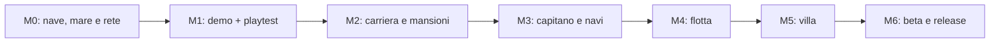

# Roadmap dalla demo alla release

Baseline 0.2, 18 ottobre 2026. **Solo pianificazione: nessun task di gameplay avviato.** Il progetto reale resta il blockout iniziale con pawn di ispezione. [Visione confermata e decisioni aperte](Vision.md).

## Percorso incrementale

Ogni fase termina con evidenze e una decisione. Un gate fallito resta aperto e blocca l'espansione: si aggiungono correzioni atomiche stimate, si aggiorna il grafo e si riprova. L'ordine delle foglie è dato dalle dipendenze, non dal numero della issue.

| Milestone / epic | Risultato verificabile | Foglie | OA | OH iniziali | Uscita |
| --- | --- | --- | --- | --- | --- |
| [M0 - Fondamenta cooperative e mare](https://github.com/CourteousWinter/A-Flag-of-Your-Own/milestone/1) / [#15](https://github.com/CourteousWinter/A-Flag-of-Your-Own/issues/15) | Due-quattro client, nave fisica e ponte percorribile; mare e vento coerenti. Gate tecnico prima della demo. | 15 | 68 | 3.35 | [#34](https://github.com/CourteousWinter/A-Flag-of-Your-Own/issues/34) |
| [M1 - Demo cooperativa: primo imbarco](https://github.com/CourteousWinter/A-Flag-of-Your-Own/milestone/2) / [#16](https://github.com/CourteousWinter/A-Flag-of-Your-Own/issues/16) | Viaggio breve con pulizia, cucina e stiva; ruoli iniziali, esperienza personale, salvataggio e playtest del divertimento. | 18 | 70 | 11.25 | [#48](https://github.com/CourteousWinter/A-Flag-of-Your-Own/issues/48) |
| [M2 - Carriera e vita di bordo](https://github.com/CourteousWinter/A-Flag-of-Your-Own/milestone/3) / [#17](https://github.com/CourteousWinter/A-Flag-of-Your-Own/issues/17) | Cinque ruoli sbloccabili, nuovi imbarchi e mansioni navali giocabili; verifica della progressione cooperativa. | 14 | 50 | 7.25 | [#62](https://github.com/CourteousWinter/A-Flag-of-Your-Own/issues/62) |
| [M3 - Capitano, equipaggio e nave propria](https://github.com/CourteousWinter/A-Flag-of-Your-Own/milestone/4) / [#18](https://github.com/CourteousWinter/A-Flag-of-Your-Own/issues/18) | Comando, equipaggio NPC entro 20 per nave, proprieta e famiglie di navi low poly secondo budget approvato. | 15 | 78 | 11.25 | [#77](https://github.com/CourteousWinter/A-Flag-of-Your-Own/issues/77) |
| [M4 - Flotta e spedizioni](https://github.com/CourteousWinter/A-Flag-of-Your-Own/milestone/5) / [#19](https://github.com/CourteousWinter/A-Flag-of-Your-Own/issues/19) | Acquisire piu navi, nominare capitani e dirigere spedizioni con persistenza e passaggio fra simulazione vicina e delegata. | 8 | 36 | 5.5 | [#85](https://github.com/CourteousWinter/A-Flag-of-Your-Own/issues/85) |
| [M5 - Villa sull isola](https://github.com/CourteousWinter/A-Flag-of-Your-Own/milestone/6) / [#20](https://github.com/CourteousWinter/A-Flag-of-Your-Own/issues/20) | Residenza raggiungibile, crescita visibile e gestione di flotta e provviste dalla villa. | 8 | 36 | 6.5 | [#93](https://github.com/CourteousWinter/A-Flag-of-Your-Own/issues/93) |
| [M6 - Beta e release 1.0](https://github.com/CourteousWinter/A-Flag-of-Your-Own/milestone/7) / [#21](https://github.com/CourteousWinter/A-Flag-of-Your-Own/issues/21) | Integrazione, qualita del mare, accessibilita, prestazioni, regressioni cooperative e candidato distribuibile del perimetro confermato. | 16 | 72 | 26 | [#108](https://github.com/CourteousWinter/A-Flag-of-Your-Own/issues/108) + pacchetto [#109](https://github.com/CourteousWinter/A-Flag-of-Your-Own/issues/109) |

**Demo provabile e valutata (M0 + M1): 138 OA, 14.6 OH iniziali, 33 foglie.** Comprende fondamenta, tre minigiochi, viaggio, salvataggi, pacchetto Windows e due gruppi di prova. [Scope e criteri](Demo.md), [protocollo umano](PlaytestPlan.md).

**Intero backlog noto: 410 OA e 71.1 OH iniziali, 94 foglie in 7 epic.** Include la demo. Gli epic non aggiungono ore; la pianificazione #14 (4 OA) e lo storico chiuso sono esclusi. Gli intervalli esplorativi delle foglie sommano 205–820 OA: è sensibilità alle ipotesi, non intervallo statistico, preventivo o calendario. Le fasi lontane hanno confidenza bassa e le quantità di contenuti ancora aperte vanno approvate. Correzioni ignote, nuove richieste e ulteriori cicli di playtest aumenteranno il lavoro tracciato.

## Decisioni prima delle implementazioni

- [#22](https://github.com/CourteousWinter/A-Flag-of-Your-Own/issues/22) — Spike: architettura cooperativa, identita e connessione privata.
- [#23](https://github.com/CourteousWinter/A-Flag-of-Your-Own/issues/23) — Spike: scegliere stack per onde, galleggiamento e vento.
- [#24](https://github.com/CourteousWinter/A-Flag-of-Your-Own/issues/24) — Definire stile low poly e scheda della nave demo.
- [#49](https://github.com/CourteousWinter/A-Flag-of-Your-Own/issues/49) — Definire requisiti di bordo per i cinque ruoli.
- [#63](https://github.com/CourteousWinter/A-Flag-of-Your-Own/issues/63) — Decidere proprieta, denaro e permessi nel gruppo cooperativo.
- [#64](https://github.com/CourteousWinter/A-Flag-of-Your-Own/issues/64) — Approvare catalogo navale, epoca e budget contenuti.
- [#78](https://github.com/CourteousWinter/A-Flag-of-Your-Own/issues/78) — Definire limiti e regole della flotta cooperativa.
- [#86](https://github.com/CourteousWinter/A-Flag-of-Your-Own/issues/86) — Definire villa, isola e crescita della residenza.
- [#94](https://github.com/CourteousWinter/A-Flag-of-Your-Own/issues/94) — Congelare il perimetro e la matrice contenuti della 1.0.

Le scelte di proprietà condivisa, catalogo delle navi, numero di unità della flotta, livelli della villa e durata non sono decisioni già approvate. Le issue dipendenti restano in backlog fino all'esito della decisione e al raffinamento. Non vengono aggiunti implicitamente combattimento, PvP, MMO o costruzione libera.

## Condizioni per la release

L'arco di carriera deve funzionare dal nuovo personaggio alla villa: ruoli scelti a ogni imbarco, esperienza personale persistente, navi proprie, equipaggio entro venti NPC sulla nave maggiore, flotta e gestione dall'isola. Lavori operativi giocabili come minigiochi, mare/vento coerenti e cooperativa fino a quattro utenti sono criteri trasversali, non aggiunte finali.

La beta verifica anche ritmo naturale, utilità dei ruoli e ripetitività: profili accelerati di QA non sostituiscono la prova dell'esperienza. Il gate finale richiede zero P0/P1 sul percorso, verifica di salvataggi/rete/prestazioni, audit delle licenze e decisione del responsabile. Il task successivo consegna il pacchetto 1.0 con versione, requisiti e note; una pubblicazione su store richiede destinazione e autorizzazione specifiche.

## Storia e gestione del piano

La baseline 0.1 su nave ferma (21 OA / 1.35 OH) è superata dalle decisioni cooperative e di simulazione. Le issue #6–#11 vengono riutilizzate e conservano la stima iniziale; #4 e #5 rimangono chiuse come storico. Non sommare baseline vecchia e nuova.

Prima di iniziare una foglia: confermare responsabile, scope, stima/intervallo, verifica, prerequisiti e percorsi degli asset. Le foglie lontane e quelle da 8 OA richiedono riesame; dividere se il nuovo scope supera 8 OA. Il piano non avvia implementazioni. [Metodo OA/OH](Planning.md).

[Indice completo delle issue e copertura](Backlog.md) · [Manifest versionato](Backlog.json) · [Ricerca navale e simulazione](Research/Ships.md)
